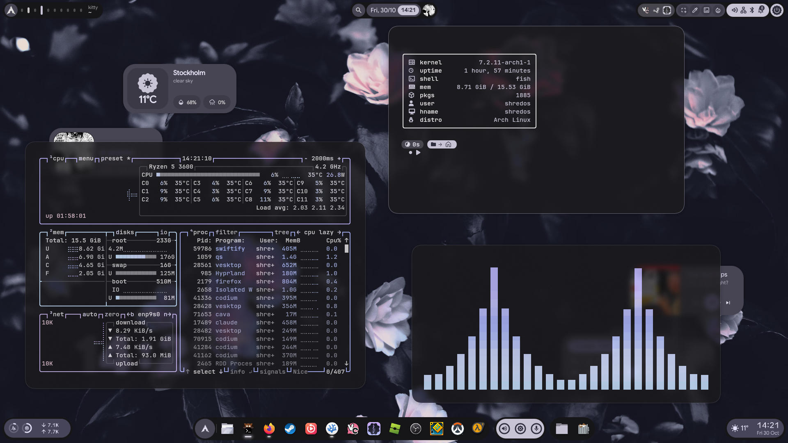
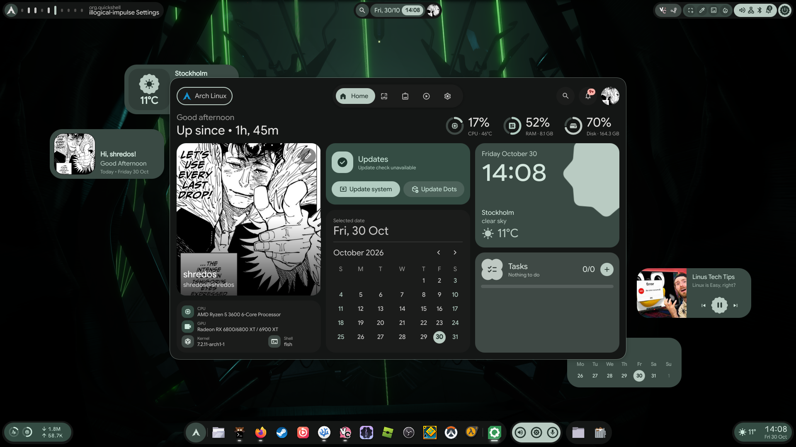
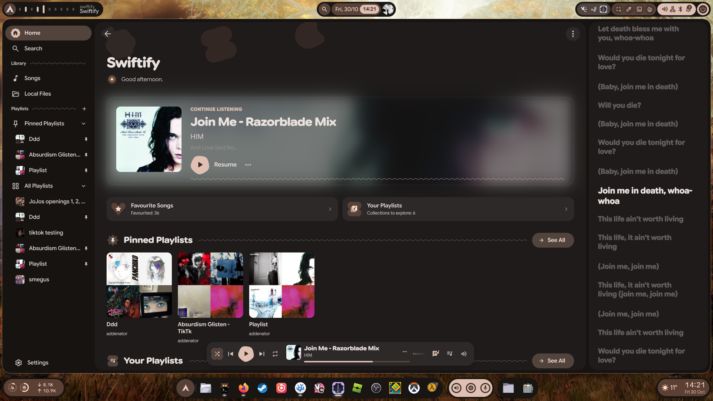
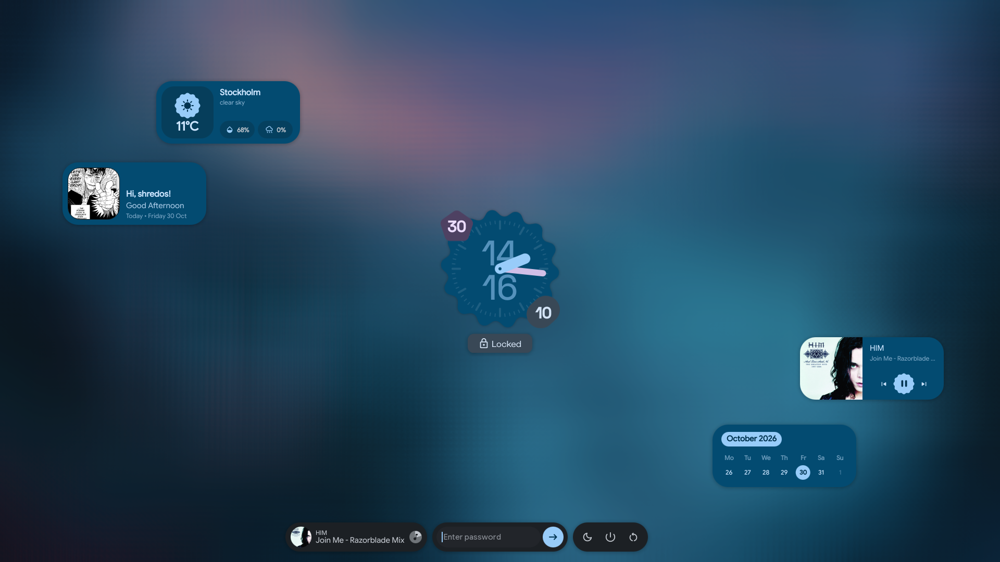

# end4-ss

### my hyprland and quickshell rice!!
its a fork of pctrade's [end4-pC](https://github.com/pctrade/end4-pC), which itself
builds on end4's [illogical impulse](https://github.com/end-4/dots-hyprland), with a bunch of my own
stuff on top, a reworked dock, a windows style start menu, clips if u play games, and a top bar that
accomodates the macbook notch. it comes with an install script for fedora asahi remix so it runs on
apple silicon macbooks.

everything follows ur wallpaper through matugen: the bar, dock, terminal, gtk and qt apps, firefox,
vesktop and even fastfetch lol


**ALL THE NSFW GOONER SHIT FROM UPSTREAM IS GONE.....** no booru sidebar, no konachan wallpapers, no nsfw
wallhaven, no anime ai personas!!!!

***made for fedora asahi remix on m1 and m2 macbooks, but the configs themselves arent mac specific, i run the same ones on my arch pc.***

## previews
first row is a workspace with btop, fastfetch and cava, and the dashboard with a different wallpaper so u can see how the colors follow it. second row is [swiftify](https://github.com/shredos67/swiftify) with synced lyrics, and the lockscreen
<table border="0">
  <tr>
    <td></td>
    <td></td>
  </tr>
  <tr>
    <td></td>
    <td></td>
  </tr>
</table>

- [Before you start](#before-you-start)
- [Whats different from upstream](#whats-different-from-upstream)
- [Installing](#installing)
  - [Flags](#flags)
  - [Running single steps](#running-single-steps)
- [The notch](#the-notch)
- [What gets installed](#what-gets-installed)
- [Keybinds](#keybinds)
- [Troubleshooting](#troubleshooting)
- [Credits](#credits)

## Before you start

- **an apple silicon macbook (m1 or m2) on fedora asahi remix 44 or 45.** every package was checked
  against the fedora aarch64 repos, so other distros or intel macs wont work with the script.
- **some patience.** a few things dont have arm packages (or only really old ones), so the script
  builds them from source. the first run takes a while.
- **ur old configs are safe.** running it again keeps ur configs and settings, only the shell and
  hyprlands core files get updated and new settings get added to config.json. anything the script
  replaces gets moved to `~/.local/share/end4-pc-dotfiles/backup-<date>/` first.

## Whats different from upstream

- **dock.** start button, trash and downloads buttons, drag to reorder, widgets with their own
  popups (media, wifi, volume, notifications, calendar) and a ton of style options
  (islands, m3, glass, indicators, animations)
- **start menu.** a windows style start menu on super, with pinned apps, recent files and search
- **clips.** instant replay clipping with gpu-screen-recorder, plus a little clip library
- **notch support.** with the bar at the top, the middle modules split to both sides of the notch
  instead of hiding behind it
- **no nsfw.** see above lol

## Installing

```sh
git clone https://github.com/shredos67/end4-SS.git
cd end4-SS
./install.sh
```

then reboot, log in, and choose a wallpaper in the welcome window.
that generates the colors for everything else.

### Flags

| flag | |
|---|---|
| `--with-clips` | also builds gpu-screen-recorder for clips |
| `--no-notch` | leaves the notch area hidden |
| `--reset` | swaps ur configs for the repos instead of keeping them (on a mac run `--reset dots asahi notch`) |

`--with-clips` turns on rpm fusion and swaps `ffmpeg-free` for the full `ffmpeg`. apple gpus dont
have a video encoder linux can use, so clips get encoded on the cpu (libx264) on macs.

### Running single steps

u can run any step on its own, like to update the shell, or to link a firefox profile u
made after installing:

```sh
./install.sh dots
./install.sh firefox
```

| step | |
|---|---|
| `packages` | turns on the coprs and installs the packages |
| `quickshell` | builds quickshell 0.3.2 |
| `tools` | matugen, obs-cmd and starship |
| `darkly` | builds the darkly qt style |
| `python` | the python venv the color scripts use |
| `dots` | updates the shell, and adds the configs u dont have yet and the default wallpaper |
| `asahi` | macbook display and trackpad settings |
| `notch` | turns on the notch area and the notch aware bar |
| `firefox` | links the matugen firefox theme into ur profile |
| `system` | gtk/qt themes, cursor, fonts, user groups and fish as ur login shell |
| `login` | sets up greetd + tuigreet as the login screen if u dont have one (like on a minimal install) |
| `clips` | builds gpu-screen-recorder (same as `--with-clips`) |
| `restore` | puts back the configs from a backup (the newest one with ur settings, or `--from=<folder>`) |

## The notch

asahi hides the strip of screen next to the notch by default. on notched macbooks (13"/15" m2 air,
14"/16" m1/m2 pro and max) the script turns it on with the `appledrm.show_notch=1` kernel
argument and turns on the notch aware bar. it kicks in after a reboot.

with the bar at the top, the middle modules get split in half around a gap in the middle of the
screen, so nothing ends up behind the notch. u can change it in **Settings → Bar → Keep the notch
clear / Notch width**, or in `~/.config/illogical-impulse/config.json`:

```json
"bar": {
    "notch": {
        "enable": true,
        "screen": "eDP-1",
        "width": 360,
        "splitIndex": -1
    }
}
```

| option | |
|---|---|
| `enable` | keeps the notch clear on a top bar |
| `screen` | the screen with the notch (`""` means every screen) |
| `width` | the gap in physical pixels, it gets scaled with the monitor automatically |
| `splitIndex` | middle modules before this go left of the notch, the rest go right. `-1` splits them in half |

the widths are guesses for now, so if the gap looks off just change it in settings.

to hide the notch area again:

```sh
sudo grubby --update-kernel=ALL --remove-args=appledrm.show_notch
```

## What gets installed

most of it comes from fedora itself, the rest from two coprs that have aarch64 builds:

- [sdegler/hyprland](https://copr.fedorainfracloud.org/coprs/sdegler/hyprland/) for hyprland and its tools
- [ririko66z/dots-hyprland](https://copr.fedorainfracloud.org/coprs/ririko66z/dots-hyprland/) for the fonts, cursors, icons and songrec

these dont have a usable arm package, so the script builds or downloads them:

| what | why | how |
|---|---|---|
| quickshell 0.3.2 | the arm packages are older versions | built from source |
| matugen 4.2.0 | fedora only has 3.1 | `cargo install` |
| obs-cmd | no arm linux release | built from git |
| starship | no arm copr | official arm binary |
| darkly | the copr is x86 only | built from source, falls back to breeze if it fails |
| gpu-screen-recorder | no arm build at all | built from source, only with `--with-clips` |

## Keybinds

on a mac keyboard **super is the ⌘ command key**. the f keys are media keys by default, so hold
**fn** for those.

| keys | |
|---|---|
| `Super` | start menu / search |
| `Super + Tab` | overview |
| `Super + A` / `Super + N` | left / right sidebar |
| `Super + Esc` | settings |
| `Super + /` | cheatsheet with every keybind |
| `Super + Enter` | terminal (kitty) |
| `Super + E` | file manager |
| `Super + W` | browser |
| `Super + Q` | close window |
| `Super + Alt + Space` | float / tile window |
| `Super + Shift + S` | screenshot a region |
| `Ctrl + Super + T` | wallpaper selector |
| `Super + L` | lock |
| `Ctrl + Alt + Delete` | session menu |
| `F8` | clips: save the last few seconds |
| `Ctrl + Alt + F10` | clips: start or stop recording |
| `Ctrl + Super + Alt + /` | edit ur own keybinds |

ur own keybinds, rules and settings go in `~/.config/hypr/custom/`, so they dont get overwritten
when u update.

## Troubleshooting

- **the gap around the notch is too wide or too small.** change notch width in settings → bar.
- **everything is too big or too small.** change `scale` in `~/.config/hypr/monitors.lua`
  (try `1.6` on the 13" air).
- **running the script again reset my settings.** older versions of it replaced ur configs (keyboard
  layout, wallpaper, dock, bar, fish/PATH). pull, then run `./install.sh restore` to get them back
  from the backup it made, and log out and back in.
- **clips says gpu-screen-recorder isnt installed.** run `./install.sh --with-clips clips`.
- **no colors after the first login.** pick a wallpaper with `Ctrl + Super + T`.
- **firefox isnt themed.** open firefox once so it makes a profile, then run `./install.sh firefox`.

## Credits

- [end-4/dots-hyprland](https://github.com/end-4/dots-hyprland), illogical impulse is the base of all of this
- [pctrade/end4-pC](https://github.com/pctrade/end4-pC), the fork this one is built on
- [quickshell](https://quickshell.org), [hyprland](https://hypr.land) and [matugen](https://github.com/InioX/matugen)
- [caelestia-dots](https://github.com/caelestia-dots/caelestia) for the fastfetch layout, starship and btop configs
- [darkly](https://github.com/Bali10050/Darkly)
- sdegler and ririko66z for keeping the aarch64 coprs alive
- [asahi linux](https://asahilinux.org) for making any of this run on a mac

## License

GPL-3.0, same as illogical impulse and end4-pC. see [LICENSE](LICENSE).
